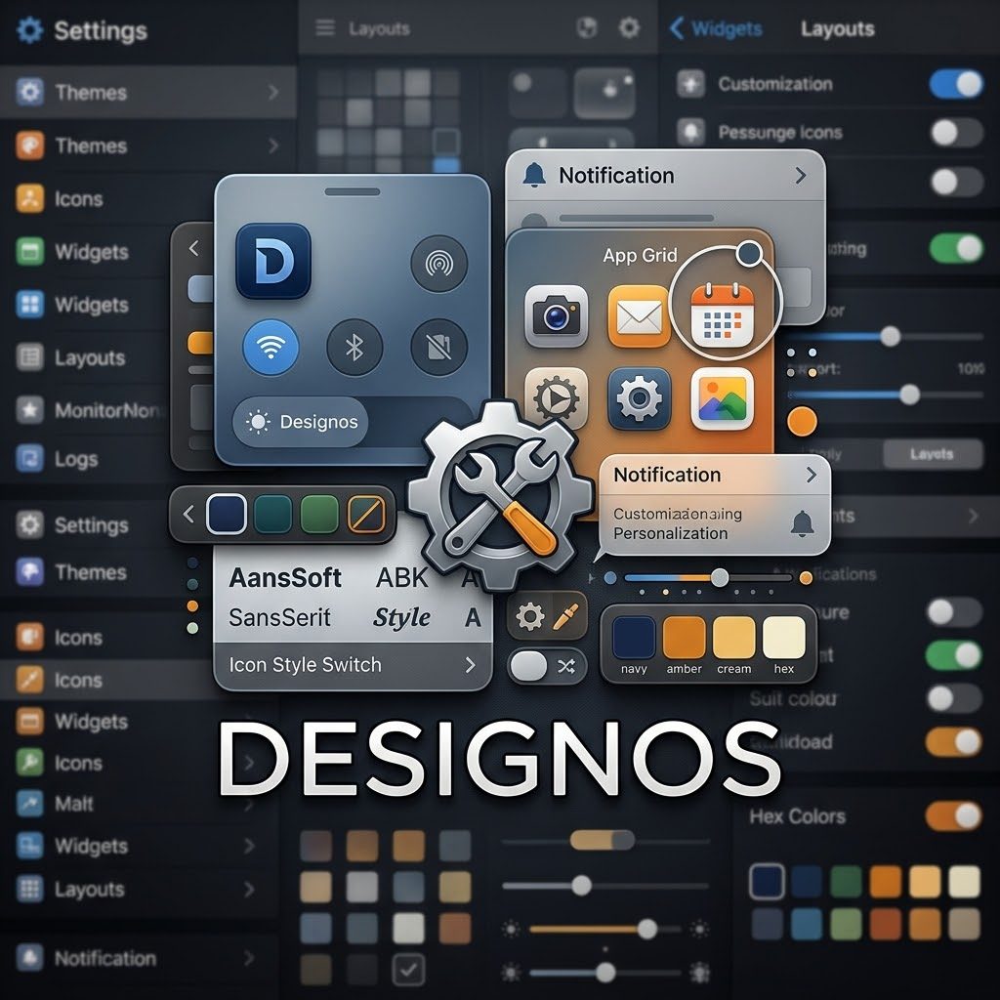

  
  
  # DESIGNOS
  
  **iPhone'unu Kendin Gibi Yap**
  
  
  
  
  

---

## 📱 Designos Nedir?

Designos, iOS (iPhone/iPad) cihazlar için hazırlanmış, **kullanıcı dostu ve modern bir tema mağazasıdır**. 

Jailbreak dünyasındaki dağınık tema dosyalarını (SnowBoard, IconBundles vb.) tek bir çatı altında toplar. Kullanıcılar kolayca tema önizleyebilir, indirebilir ve cihazlarına uygulayabilir.

## ✨ Özellikler

- 🎨 **Modern Arayüz:** iOS estetiğine uygun koyu tema ve şık tasarım.
- ⚡ **Hızlı Erişim:** Tek tıkla tema önizleme ve indirme.
- 📦 **Uyumlu Formatlar:** `.zip` ve `.deb` formatlarında tema desteği.
- 🛠️ **Topluluk Odaklı:** GitHub üzerinden tema gönderme ve paylaşma altyapısı.

## 🧩 Gerekli Araçlar (Jailbreak)

Temaları kullanabilmek için cihazınızda **SnowBoard** yüklü olmalıdır. 
SnowBoard tamamen ücretsizdir ve iOS 16 (Rootless) sürümünü destekler. Resmi **SparkDev** reposundan indirebilirsiniz.

- **SparkDev Repo:** [https://sparkdev.me](https://sparkdev.me)

## 🚀 Nasıl Kullanılır?

1. Tarayıcınızdan [Designos Web Sitesi](https://desingosrepo.github.io/Desingos/) adresine gidin.
2. Beğendiğiniz temayı bulun ve **"İndir"** butonuna tıklayın.
3. İndirdiğiniz `.zip` dosyasını **Filza** uygulaması ile açın.
4. İçindeki tema klasörünü `/var/jb/Library/Themes/` dizinine taşıyın. *(Rootless jailbreak kullanıyorsanız yol bu şekildedir)*
5. **Ayarlar > SnowBoard** menüsüne gidin, temayı seçin ve **Respring** yapın.
6. İkonlarınızın keyfini çıkarın! 🎉

## 🛠️ Geliştirici / Katkıda Bulunma

Bu proje açık kaynaktır ve topluluk katkılarına açıktır!
Yeni bir tema eklemek veya siteyi geliştirmek istiyorsanız bir **Pull Request** açabilirsiniz.

---

  <i>Designos ile iPhone'unuzu kişiselleştirin.</i>

